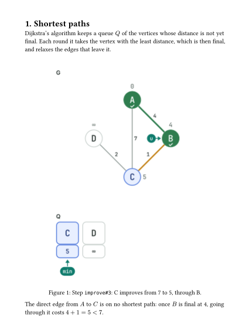
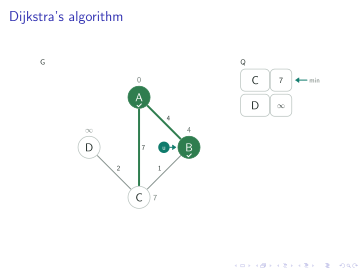
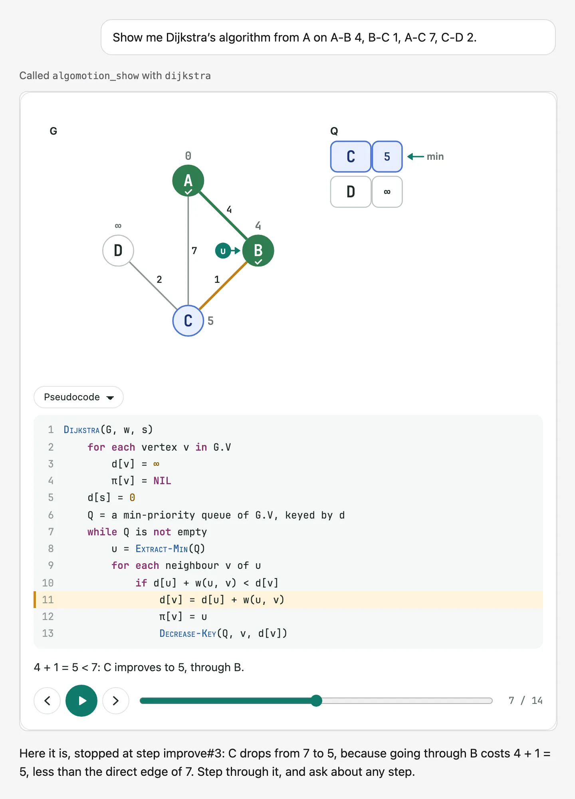

<p align="center">
  <picture>
    <source media="(prefers-color-scheme: dark)" srcset="docs/brand/lockup-dark.svg">
    
  </picture>
</p>

<p align="center">把算法的每一步都画出来：网页上的播放器、Typst 和 LaTeX 笔记里的插图、幻灯片上逐步出现的叠层，以及 AI 对话里的播放器，都只需要一个算法名和你的输入。</p>

<p align="center">
  <a href="https://algomotion.turing2234.com/zh/">网站</a> ·
  <a href="https://algomotion.turing2234.com">English</a> ·
  <a href="https://algomotion.turing2234.com/zh/guide/">指南</a> ·
  <a href="https://algomotion.turing2234.com/zh/algorithms/">132 个算法</a> ·
  <a href="https://algomotion.turing2234.com/play/#v=1&amp;alg=dijkstra&amp;in=A-B%204%2C%20B-C%201%2C%20A-C%207%2C%20C-D%202">在线试试</a>
</p>

[English README](README.md)

## 它做什么

说出算法名，再给出输入，写法和你平时在纸上写的一样：列表 `5 2 4 6 1 3`，图 `A-B 4, B-C 1`，或者一串操作 `insert 4, delete 3`。algomotion 运行这个算法，记下每一步：改了什么、执行的是代码的哪一行，并用一句话说明原因。每一步都有名字，比如 `relax#3` 是第三次松弛，笔记、幻灯片和链接都可以直接引用它。

| Typst 笔记                                                                                          | Beamer 幻灯片                                                                                             | AI 对话                                                                                 |
| --------------------------------------------------------------------------------------------------- | --------------------------------------------------------------------------------------------------------- | --------------------------------------------------------------------------------------- |
|  |  |  |

同一次运行可以变成上面任何一种形式，都由同一个引擎绘制，有九种主题可选。模型也可以通过 MCP 服务器自己编写可视化，逐步校验，再在对话里展示出来。

目前解说和播放器界面只有英文，中文已列入路线图。

## 现状：1.0 alpha

协议已冻结在 1.0，十一种数据结构和 132 个算法及数据结构操作都已完整可用。`1.0.0-alpha.1` 是第一个公开版本，供试用和反馈：在 1.0 之前，名称和选项仍可能调整。

- **npm**：所有包都以 `alpha` 标签发布，直接 `npm install` 不会装到它，需要指定 `@alpha`。
- **Typst Universe 和 CTAN**：暂未发布。这两个平台都由人工审核，并且会永久保留每个版本，所以等 1.0 再上。在那之前，可以从 [GitHub Release](https://github.com/Eryc123Y/algorithm-visualizer/releases) 或本仓库在本地安装 Typst 和 LaTeX 包，方法见 [Typst 指南](https://algomotion.turing2234.com/zh/guide/typst/)和 [LaTeX 指南](https://algomotion.turing2234.com/zh/guide/latex/)。
- **AI 助手**：托管的 MCP 服务器 `https://algomotion-mcp.turing2234.com/mcp` 现在就能用。

## 快速上手

在网页上使用（从 npm 安装播放器）：

```sh
npm install @algomotion/elements@alpha
```

```js
import '@algomotion/elements/define';
```

```html
<algo-player
  algorithm="dijkstra"
  input="A-B 4, B-C 1, A-C 7, C-D 2"
></algo-player>
```

在命令行里导出插图：

```sh
npx -p @algomotion/mcp@alpha algomotion export dijkstra --input 'A-B 4, B-C 1, A-C 7, C-D 2' --step improve#3 --out figures
```

在 Claude Code 里接入：

```sh
claude mcp add --transport http algomotion https://algomotion-mcp.turing2234.com/mcp
```

在 Typst 里（先按 [Typst 指南](https://algomotion.turing2234.com/zh/guide/typst/)在本地安装）：

```typ
#import "@local/algomotion:0.1.0": algomotion
#algomotion("dijkstra", "A-B 4, B-C 1, A-C 7, C-D 2", step: "improve#3")
```

在 LaTeX 里（`algomotion.sty` 和 `algomotion` 命令都要能找到，见 [LaTeX 指南](https://algomotion.turing2234.com/zh/guide/latex/)）：

```latex
\usepackage{algomotion}
\algomotion[step=improve\#3]{dijkstra}{A-B 4, B-C 1, A-C 7, C-D 2}
```

更多内容见[英文 README](README.md) 和[中文网站](https://algomotion.turing2234.com/zh/)。

## 参与贡献

欢迎提 issue 和 pull request，流程见 [CONTRIBUTING.md](CONTRIBUTING.md) 和[网站上的贡献指南](https://algomotion.turing2234.com/zh/contributing/)。

## 许可证

algomotion 是自由软件，采用 GNU 通用公共许可证第 3 版或更高版本（[LICENSE](LICENSE)）。它画出的图和生成的文档归你所有。随附的字体保留各自的许可证，即 SIL 开放字体许可证 1.1。
